# Laundry Service Management System

A Flutter and FastAPI/PostgreSQL laundry management platform developed for Kenya, supporting both formal laundry businesses and informal **Mama Fua / Jua Kali** laundry service providers.

The system connects customers with laundry service providers through an Android application. Customers can discover providers, explore available services, place laundry orders and track their requests. Providers can manage their profiles, services and customer orders, while administrators oversee users, providers and platform activities.

> **Project Status:** Academic prototype. The core application and backend have been developed. USSD, SMS and M-Pesa payment integrations are not currently operational and require further integration, configuration and testing.

---

## Contents

1. [Project Overview](#project-overview)
2. [Key Features](#key-features)
3. [Application Screenshots](#application-screenshots)
4. [Technology Stack](#technology-stack)
5. [System Architecture](#system-architecture)
6. [User Roles](#user-roles)
7. [Database Design](#database-design)
8. [Project Structure](#project-structure)
9. [Installation](#installation)
10. [Running the Application](#running-the-application)
11. [Android APK](#android-apk)
12. [USSD, SMS and M-Pesa Status](#ussd-sms-and-m-pesa-status)
13. [Security](#security)
14. [Testing](#testing)
15. [Project Limitations](#project-limitations)
16. [Future Improvements](#future-improvements)
17. [Academic Project](#academic-project)

---

## Project Overview

The Laundry Service Management System is designed to improve access to laundry services by connecting customers with both formal laundry businesses and informal Mama Fua / Jua Kali service providers through a digital platform.

The system provides:

- A Flutter Android application.
- Customer registration and account management.
- Laundry provider registration and management.
- Laundry service discovery and booking.
- Order management and tracking.
- An administrator interface.
- A FastAPI backend.
- A PostgreSQL database.

The project aims to make laundry service delivery more accessible, organized and convenient for customers and service providers in Kenya.

---

## Key Features

### Customer Features

- Customer registration and login.
- Customer dashboard.
- Browse available laundry providers.
- Search and filter providers.
- View provider profiles.
- Explore available laundry services.
- View service prices.
- Place laundry orders.
- View order details.
- Track laundry order progress.
- View order statuses such as Pending, Approved, Processing and Completed.
- Cancel orders where applicable.
- Submit ratings and reviews.
- Manage customer profile.
- Update profile information.
- Submit help and support requests.
- Receive application notifications.

### Provider Features

The provider interface supports formal laundry businesses and informal Mama Fua / Jua Kali service providers.

- Provider registration.
- Provider profile management.
- Specify provider type.
- Set washing and ironing methods.
- Add laundry services.
- Set service prices.
- Set turnaround time.
- Set daily service capacity.
- Manage service availability.
- View incoming customer orders.
- Accept or reject orders.
- Update order status.
- Manage existing services.
- View provider dashboard information.

### Administrator Features

- Administrator dashboard.
- View platform statistics.
- Manage customer accounts.
- Manage laundry providers.
- Activate and deactivate accounts.
- Verify providers.
- View and manage orders.
- View customer support requests.

---

## Application Screenshots

The application uses a **light rose/pink design system**, featuring a soft pink background, white cards, magenta action buttons, deep plum text and rounded interface components.

### Main Interface

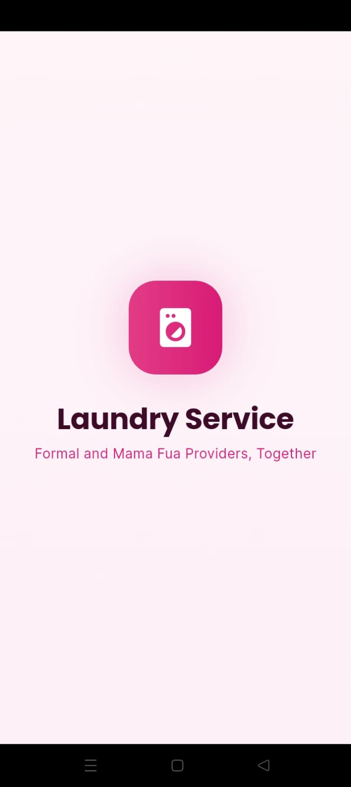

### Customer Form

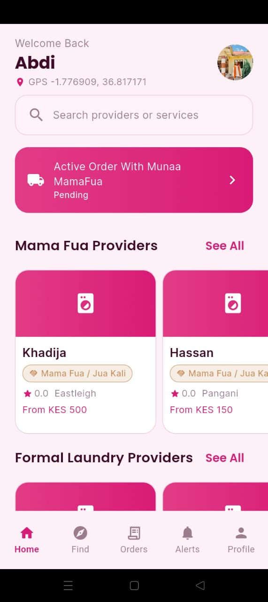

### Login Form

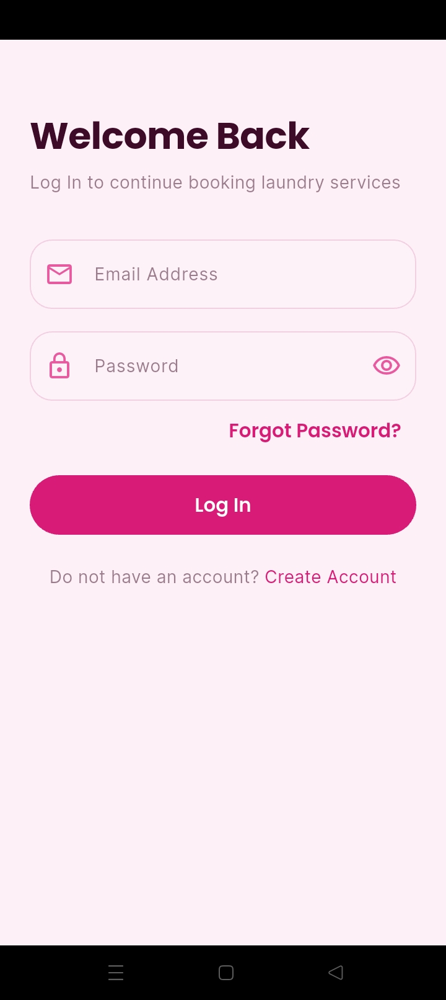

### Provider Form


### Profiles

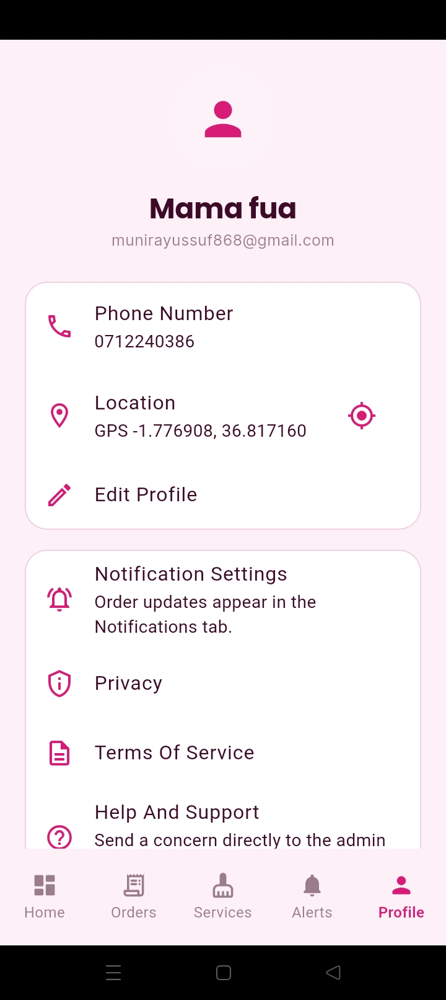

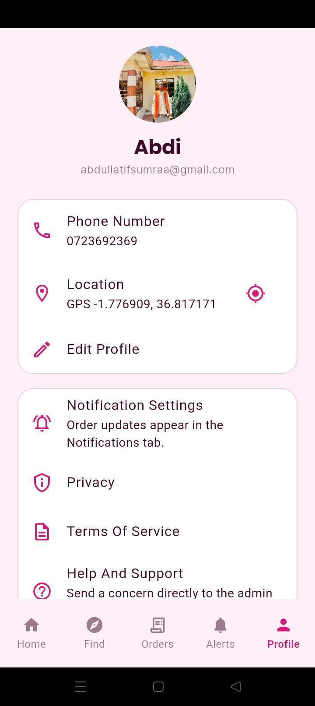

### Notifications

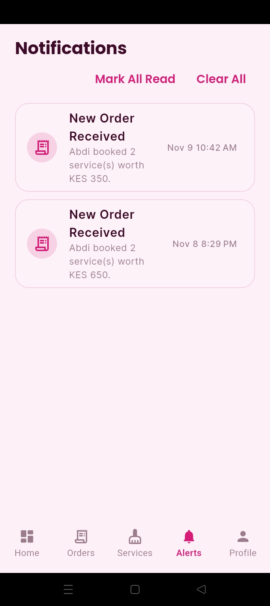

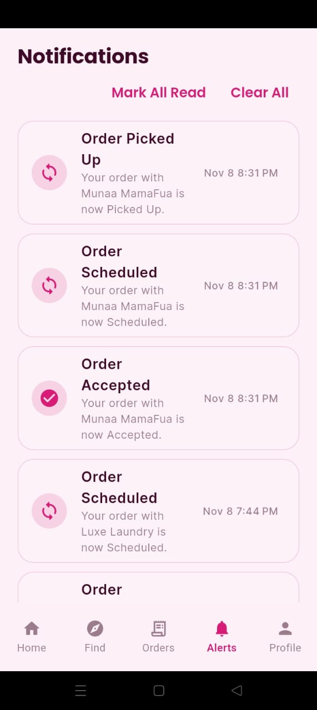

### Orders

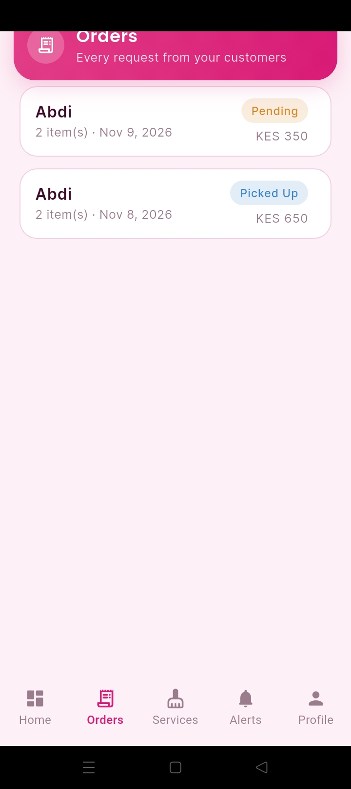

### Services

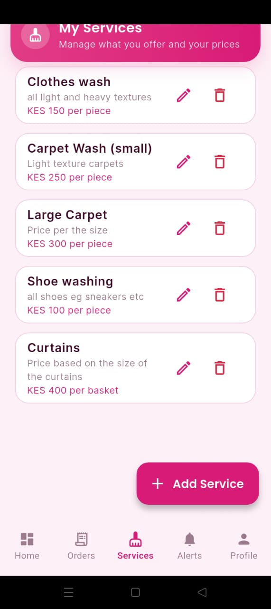

### Services Provided

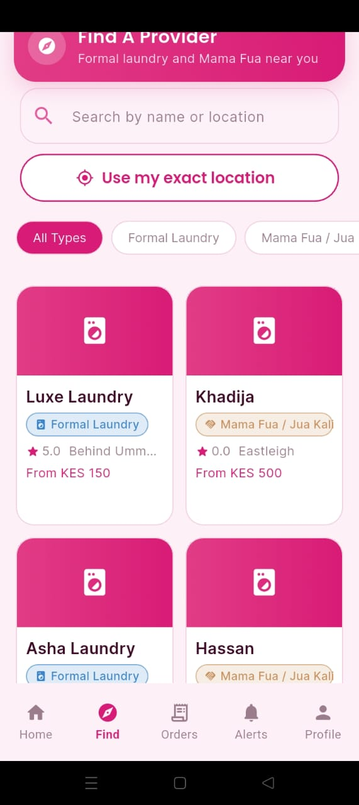

### Order Tracking

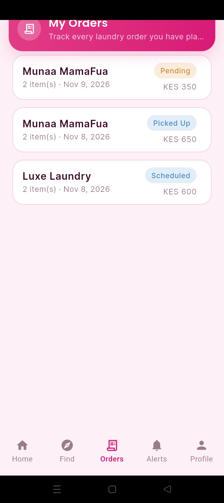

The order tracking interface allows customers to follow the progress of their laundry requests, including statuses such as Pending, Approved, Processing and Completed.

---

## Technology Stack

| Component | Technology |
|---|---|
| Frontend Framework | Flutter |
| Programming Language | Dart |
| State Management | Riverpod |
| Navigation | go_router |
| Backend Framework | FastAPI |
| Backend Language | Python |
| Database | PostgreSQL |
| ORM | SQLAlchemy |
| Authentication | JWT |
| API Communication | REST API |
| Development Environment | Android Studio |
| Version Control | Git and GitHub |

---

## System Architecture

The system follows a client-server architecture.

```text
       Flutter Android Application
                   |
                   |
                REST API
                   |
                   ▼
             FastAPI Backend
                   |
                   |
                   ▼
             PostgreSQL
                Database
```

### Frontend

The Flutter application provides the interfaces used by customers, laundry providers and administrators.

### Backend

The FastAPI backend handles application requests, authentication, user management, provider information, services, orders and other system operations.

### Database

PostgreSQL stores the application's data, including users, providers, services, orders, reviews and notifications.

---

## User Roles

The system has three main user roles.

| User Role | Responsibilities |
|---|---|
| Customer | Discover laundry providers, view services, place orders and track laundry requests. |
| Provider | Manage laundry services, receive customer orders and update order progress. |
| Administrator | Manage customers, providers, orders and support requests. |

---

## Database Design

The application uses PostgreSQL for data storage and management.

The main database entities include:

| Entity | Description |
|---|---|
| Users | Stores customer, provider and administrator account information. |
| Providers | Stores laundry provider profiles, locations, availability and business details. |
| Services | Stores laundry services offered by providers and their prices. |
| Orders | Stores customer bookings, selected services, order details and order status. |
| Payments | Stores payment-related records associated with orders. |
| Notifications | Stores notifications generated for users. |
| Reviews | Stores customer ratings and reviews. |
| Support Messages | Stores customer support requests. |
| USSD Sessions | Provides storage for USSD session information. |

---

## Project Structure

```text
laundry_service_app/
│
├── android/
│
├── assets/
│
├── lib/
│   ├── core/
│   │   ├── constants/
│   │   ├── models/
│   │   ├── providers/
│   │   ├── repositories/
│   │   ├── routes/
│   │   ├── services/
│   │   ├── theme/
│   │   └── widgets/
│   │
│   ├── features/
│   │   ├── auth/
│   │   ├── customer/
│   │   ├── provider/
│   │   ├── admin/
│   │   ├── notifications/
│   │   └── profile/
│   │
│   └── main.dart
│
├── backend/
│   └── app/
│
├── screenshots/
│   ├── Interface.jpeg
│   ├── Customerform.jpeg
│   ├── loginform.jpeg
│   ├── Providerform.jpeg
│   ├── profilee.jpeg
│   ├── profile.jpeg
│   ├── notifications.jpeg
│   ├── notificationss.jpeg
│   ├── Orders.jpeg
│   ├── Services.jpeg
│   ├── servicesprovided.jpeg
│   └── track.jpeg
│
├── legacy_firebase_functions/
├── firestore/
├── tools/
├── pubspec.yaml
├── docker-compose.yml
└── README.md
```

The `legacy_firebase_functions/` directory contains an earlier Firebase implementation. The current application uses FastAPI and PostgreSQL.

---

## Installation

### Requirements

- Flutter SDK
- Dart SDK
- Android Studio
- Python
- PostgreSQL
- Git

### Clone the Repository

```bash
git clone <your-repository-url>
cd laundry_service_app
```

### Install Flutter Dependencies

```bash
flutter pub get
```

### Run the Flutter Application

```bash
flutter run
```

### Backend Setup

The backend uses FastAPI and PostgreSQL.

Install the required Python dependencies, configure the PostgreSQL database connection and set the necessary environment variables.

Example command:

```bash
uvicorn app.main:app --reload
```

The backend must be running and accessible through the API URL configured in the Flutter application.

---

## Running the Application

The system consists of two main components.

### Flutter Frontend

The Flutter frontend provides the user interfaces for:

- Customers.
- Laundry providers.
- Administrators.

### FastAPI Backend

The backend manages:

- Authentication.
- User accounts.
- Provider information.
- Laundry services.
- Customer orders.
- Order status updates.
- Reviews.
- Notifications.
- Support requests.
- Database operations.

The Flutter application communicates with the backend through REST API requests.

---

## Android APK

An Android APK is provided for application demonstration and academic evaluation.

### Download the Application

**[Download Laundry Management System APK](https://drive.google.com/file/d/1aug1fc6mq7A5uztVMmQ8E5wR8wI787p0/view?usp=sharing)**

The APK can be downloaded and installed on a compatible Android device.

### Generate an APK

To generate a release APK, run:

```bash
flutter build apk --release
```

The generated file will be available at:

```text
build/app/outputs/flutter-apk/app-release.apk
```

To generate smaller APKs for different processor architectures:

```bash
flutter build apk --split-per-abi
```

---

## USSD, SMS and M-Pesa Status

The project was designed to support additional communication and payment services to improve accessibility and convenience.

However, the following integrations are not currently operational in the submitted prototype.

### USSD Integration

USSD functionality was included in the project design to allow customers using feature phones to access laundry services without requiring a smartphone or internet connection.

The USSD integration is not currently operational because the external service connection and configuration have not been completed.

**Status: Not operational.**

### SMS Integration

SMS functionality was planned to provide customers and laundry providers with order updates and notifications.

The SMS gateway integration has not been successfully connected and tested.

**Status: Not operational.**

### M-Pesa Payment Integration

M-Pesa integration was planned to allow customers to pay for laundry services through mobile money.

The Safaricom Daraja payment integration is not currently working in the submitted prototype.

**Status: Not operational.**

These integrations are areas for further development and require the appropriate third-party accounts, credentials, callback configurations and testing.

---

## Security

The backend uses JWT-based authentication to manage authenticated API requests.

The application also separates access according to user roles:

- Customer
- Provider
- Administrator

Sensitive credentials and database configuration should be stored in environment variables and should not be uploaded to the public GitHub repository.

---

## Testing

The application has been developed with customer, provider and administrator workflows.

The following core functions are included in the application's testing scope:

- User registration and login.
- Customer account management.
- Provider registration.
- Provider discovery.
- Provider profile viewing.
- Service management.
- Laundry booking.
- Order creation.
- Order tracking.
- Order status updates.
- Profile management.
- Notifications.
- Reviews and ratings.
- Administrator management functions.

External integrations such as USSD, SMS and M-Pesa require further testing after their connections are completed.

### Feature Status

| Feature | Status |
|---|---|
| Flutter Android Application | Implemented |
| FastAPI Backend | Implemented |
| PostgreSQL Database | Implemented |
| Customer Interface | Implemented |
| Provider Interface | Implemented |
| Administrator Interface | Implemented |
| Laundry Service Management | Implemented |
| Order Management | Implemented |
| Order Tracking | Implemented |
| USSD Integration | Not operational |
| SMS Integration | Not operational |
| M-Pesa Integration | Not operational |

---

## Project Limitations

The current prototype has the following limitations:

- USSD functionality is not operational.
- SMS notifications are not operational.
- M-Pesa payment integration is not operational.
- External service configurations require further development.
- The application is currently focused on Android.
- Additional testing is required before production deployment.

---

## Future Improvements

Future development may include:

- Fully operational USSD access.
- SMS notifications and order updates.
- M-Pesa payment integration.
- Customer-provider communication.
- Push notifications.
- Advanced reports and analytics.
- Improved offline functionality.
- Cloud-based image storage.
- Expanded automated testing.
- Support for additional mobile platforms.

---

## Academic Project

This project was developed as a **Bachelor of Science in Information Technology final-year academic project** at **Umma University, Kenya**.

### Project Title

**Laundry Service Management System: An Inclusive Digital Platform for Formal and Informal (Mama Fua/Jua Kali) Laundry Service Delivery**

The project focuses on using digital technology to improve access to laundry services while providing formal and informal laundry service providers with a platform for managing their services and customer orders.

---

## Developer

**Munira Yussuf Suraw**

Bachelor of Science in Information Technology  
Umma University, Kenya

---

## License

This project was developed for academic purposes.
